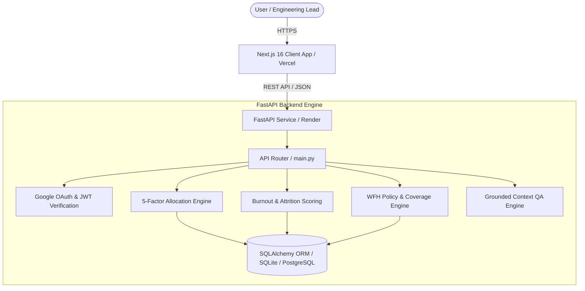

# ORKA — The AI Decision Engine for Engineering Teams

> **Explainable AI decisions for smarter engineering-team execution.**

[](https://github.com/kartikthhakur07/Orka/actions/workflows/ci.yml)
[](https://orka-nu.vercel.app)
[](https://orkapi.onrender.com/docs)
[](https://www.python.org)
[](https://nextjs.org)

ORKA is an enterprise decision-support engine designed to optimize task allocation, sprint capacity, burnout prevention, hybrid work schedules, and project delivery risk. By unifying team signals—including skills, workload headroom, daily availability, cognitive overload indicators, and project deadlines—ORKA turns complex engineering trade-offs into explainable, policy-compliant recommendations.

* **Live Application:** [https://orka-nu.vercel.app](https://orka-nu.vercel.app)
* **GitHub Repository:** [https://github.com/kartikthhakur07/Orka](https://github.com/kartikthhakur07/Orka)
* **Backend API Base:** [https://orkapi.onrender.com](https://orkapi.onrender.com)
* **Interactive API Documentation:** [https://orkapi.onrender.com/docs](https://orkapi.onrender.com/docs)

---

## Table of Contents

- [1. Problem Statement](#1-problem-statement)
- [2. Solution Overview](#2-solution-overview)
- [3. Core Features](#3-core-features)
- [4. Key Differentiators](#4-key-differentiators)
- [5. System Architecture](#5-system-architecture)
- [6. Task Delegation Algorithm](#6-task-delegation-algorithm)
- [7. Technology Stack](#7-technology-stack)
- [8. Repository Structure](#8-repository-structure)
- [9. Installation and Local Setup](#9-installation-and-local-setup)
- [10. Environment Variables](#10-environment-variables)
- [11. API Reference](#11-api-reference)
- [12. Screenshots and UI Overview](#12-screenshots-and-ui-overview)
- [13. Testing and Quality](#13-testing-and-quality)
- [14. Security and Responsible AI](#14-security-and-responsible-ai)
- [15. Known Limitations](#15-known-limitations)
- [16. Product Roadmap](#16-product-roadmap)
- [17. Contributing](#17-contributing)
- [18. License](#18-license)

---

## 1. Problem Statement

Engineering managers, team leads, and operations leaders routinely navigate critical execution trade-offs under high uncertainty:

1. **Manual Task Delegation:** Assigning complex tasks relies heavily on intuition or recent recall, frequently leading to sub-optimal skill alignment.
2. **Uneven Workload Distribution:** High performers are repeatedly assigned critical path items, driving up workload while underutilizing available capacity elsewhere.
3. **Burnout and Retention Risks:** Cognitive overload, context switching, and excessive meeting density accumulate undetected until employee resignation occurs.
4. **Inefficient Sprint Planning:** Balancing daily capacity, developer leave, and task complexity across spreadsheet tools consumes hours of manual overhead per sprint.
5. **Unpredictable Deadline Slippage:** Project risk is often identified after milestone dates pass, rather than forecast dynamically from team velocity.
6. **Hybrid Work Coordination:** Coordinating office attendance and remote work policy compliance across distributed team members introduces friction and policy violations.

---

## 2. Solution Overview

ORKA aggregates multi-dimensional team operational telemetry into an explainable decision loop. Instead of acting as an opaque black box or relying on subjective evaluations, ORKA applies deterministic multi-factor scoring and constraint filtering to answer foundational operational questions:

* *Who is best qualified and available to execute a task right now?*
* *How can subtasks be distributed across daily sprint capacity without causing overload?*
* *Which team members show early signs of cognitive strain, and what supportive actions should be taken?*
* *How can a 2-day hybrid work schedule be generated automatically without violating office coverage minimums?*
* *Which project deadlines are projected to slip based on actual team velocity?*

```
┌─────────────────┐     ┌─────────────────────┐     ┌─────────────────────┐
│  Task Signals   │ ──► │  ORKA Engine        │ ──► │  Explainable        │
│  (Skills, NLP,  │     │  (5-Factor Model &  │     │  Recommendations    │
│  Deadline)      │     │  Constraint Filter) │     │  (Winner, Backup,   │
└─────────────────┘     └─────────────────────┘     │  Reason Codes)      │
                                                    └─────────────────────┘
```

---

## 3. Core Features

| Module / Feature | Status | Purpose & Functionality |
| :--- | :--- | :--- |
| **Overview Dashboard** (`/dashboard`) | 🟢 **Implemented** | Central command view aggregating team health, sprint burndown metrics, active task counts, burnout mini-lists, and recent AI task assignments. |
| **AI Task Delegator** (`/delegator`) | 🟢 **Implemented** | Evaluates tasks against team signals using the 5-factor delegation engine. Features sub-tab support for **AI Task Assign**, **Auto Task Splitter**, and **NLP Sentence Parser**. |
| **Sprint Planner** (`/sprint`) | 🟢 **Implemented** | Capacity-aware planning board that automatically breaks tasks into sub-items and schedules them into daily capacity windows ($\le 8\text{h/day}$) while respecting member availability. |
| **Burnout Radar** (`/burnout`) | 🟢 **Implemented** | 14-day cognitive overload tracking system blending workload, context switching, focus hours, meeting load, and attrition risk metrics into actionable interventions. |
| **WFH Decider** (`/wfh`) | 🟢 **Implemented** | Policy-compliant hybrid work scheduler. Evaluates commute distance, deep-work requirements, collaboration ratios, and office coverage rules to assign optimal remote days. |
| **Deadline Shield** (`/deadline`) | 🟢 **Implemented** | Velocity-based completion forecasting. Calculates projected vs. required deadline days, identifies bottleneck owners, and simulates workload rebalancing. |
| **AI Copilot** (`/copilot`) | 🟢 **Implemented** | Natural-language query interface powered by structured context retrieval. Answers operational questions regarding team load, burnout, sprint progress, and recommendations. |
| **Team Builder** (`/team`) | 🟢 **Implemented** | Roster management, squad generation based on project skill requirements (`POST /api/team/build`), and skill coverage gap analysis (`GET /api/skill-gap`). |
| **Productivity & Work DNA** (`/productivity`) | 🟢 **Implemented** | Output telemetry, non-surveillance focus profiles (**Work DNA**), focus hour heatmaps, and a meeting waste analyzer (`GET /api/meetings`). |

---

## 4. Key Differentiators

1. **Explainable Multi-Factor Allocation:** Every task recommendation provides full factor score breakdowns ($0\text{--}100$), standardized reason codes (`HIGH_SKILL_MATCH`, `CAPACITY_AVAILABLE`, `BURNOUT_SAFE`), and an identified runner-up backup.
2. **Hard Constraint Eligibility Filtering:** High burnout scores ($\ge 75\%$) or max capacity ($\ge 95\%$) automatically trigger eligibility exclusions, preventing high-skill scores from masking burnout risks.
3. **Policy-Compliant Hybrid Work Engine:** Generates fair 2-day hybrid schedules balancing commute stress against office coverage thresholds.
4. **Integrated Decision Support:** Task assignment, sprint capacity, burnout prevention, and deadline projections operate on a single shared data model rather than isolated tools.
5. **Non-Surveillance Productivity Focus:** Evaluates focus block availability, meeting density, and context switching rather than monitoring keystrokes or private messages.

---

## 5. System Architecture

ORKA follows a decoupled full-stack architecture. The frontend is built on Next.js 16 with React 19 and Tailwind CSS, deployed on Vercel. The backend is a Python FastAPI service backed by SQLAlchemy ORM, hosted on Render.



---

## 6. Task Delegation Algorithm

The core delegation engine evaluates candidates using a deterministic, multi-factor model:

$$\text{Score} = w_1 \cdot \text{SkillMatch} + w_2 \cdot \text{WorkloadHeadroom} + w_3 \cdot \text{Availability} + w_4 \cdot \text{BurnoutSafety} + w_5 \cdot \text{DeadlineFit}$$

### Factor Definitions & Normalization ($0\text{--}100$)

* **Skill Match ($K$):** Weighted overlap percentage between required task skills and member proficiency.
* **Workload Headroom ($H$):** Remaining capacity, evaluated as $\max(0, 100 - \text{Current Workload \%})$.
* **Availability ($A$):** Daily free working window, evaluated as $\min\left(100, \frac{\text{Free Hours}}{8.0} \times 100\right)$.
* **Burnout Safety ($B$):** Safety margin, evaluated as $\max(0, 100 - \text{Effective Burnout Score})$.
* **Deadline Fit ($D$):** Feasibility score based on task complexity vs. available deadline days.

### Dynamic Weighting Matrix

| Priority Level | $w_1$ (Skill) | $w_2$ (Workload) | $w_3$ (Availability) | $w_4$ (Burnout) | $w_5$ (Deadline) |
| :--- | :---: | :---: | :---: | :---: | :---: |
| **Standard / Medium / Low** | 0.30 | 0.20 | 0.20 | 0.20 | 0.10 |
| **Critical / Urgent** | 0.25 | 0.20 | 0.30 | 0.10 | 0.15 |

### Hard Constraint Eligibility Rules

Before ranking candidates by total score, the engine applies hard eligibility checks:
1. **Burnout Exclusion:** Members with an effective burnout score $\ge 75\%$ are hard-excluded from top assignment recommendations to prevent attrition.
2. **Capacity Exclusion:** Members with workload $\ge 95\%$ are excluded due to lack of headroom.
3. **Approval Flag:** Tasks marked `critical` or assignments with score $< 60$ automatically set `"requires_manager_approval": true`.

*Sample output structure (illustrative data):*

```json
{
  "assigned_to": "Hitendra",
  "confidence": 88,
  "factors": {
    "skill_match": 85.0,
    "workload_headroom": 50.0,
    "availability": 87.5,
    "burnout_safety": 72.0,
    "deadline_fit": 90.0
  },
  "reason_codes": ["HIGH_SKILL_MATCH", "CAPACITY_AVAILABLE", "BURNOUT_SAFE"],
  "backup": "Priya",
  "excluded_candidates": [
    {
      "name": "Kartik",
      "reason": "Critical burnout risk (85.0/100) — excluded to prevent turnover"
    }
  ]
}
```

---

## 7. Technology Stack

| Layer | Component / Tool | Technology |
| :--- | :--- | :--- |
| **Frontend Core** | Framework | Next.js 16.2 (App Router), React 19.2 |
| **Frontend Styling** | Styling & UI | Tailwind CSS v4, Lucide React Icons, Radix UI Dialog |
| **Frontend Data** | HTTP Client | Axios, Native Fetch with exponential backoff retry |
| **Frontend Visualization** | Data Charts | Recharts v3.9 |
| **Backend Core** | Framework | Python 3.11+, FastAPI v0.110+ |
| **Backend Web Server** | ASGI Server | Uvicorn (standard) |
| **Backend Database** | ORM & DB | SQLAlchemy ORM, SQLite (`orka.db`) / PostgreSQL ready |
| **Authentication** | OAuth 2.0 & JWT | Google Identity Services tokeninfo API, PyJWT / HMAC-SHA256 |
| **Containerization** | Container Runtime | Docker, Docker Compose (v3.8 spec) |
| **CI/CD** | Automation | GitHub Actions (`ci.yml`) |
| **Hosting & Deployment** | Cloud Platforms | Vercel (Frontend), Render (Backend API) |

---

## 8. Repository Structure

```
Orka/
├── .github/
│   └── workflows/
│       └── ci.yml                 # GitHub Actions CI pipeline (Pytest & Next.js Build)
├── backend/
│   ├── database.py                # Database connection, ORM initialization & seed data
│   ├── Dockerfile                 # Docker container specification for FastAPI service
│   ├── main.py                    # Core FastAPI app, endpoints, and 5-factor delegation logic
│   ├── model.py                   # SQLAlchemy data models (TeamMember, Task, Project, etc.)
│   ├── requirements.txt           # Python backend dependencies
│   ├── runtime.txt                # Python runtime specification (Python 3.11.9)
│   └── test_main.py               # Pytest integration test suite
├── frontend/
│   ├── public/                    # Static assets, logos, icons
│   ├── src/
│   │   ├── app/                   # Next.js App Router pages (dashboard, delegator, etc.)
│   │   │   ├── burnout/           # Burnout Radar page component
│   │   │   ├── copilot/           # AI Copilot page component
│   │   │   ├── dashboard/         # Overview Dashboard page component
│   │   │   ├── deadline/          # Deadline Shield page component
│   │   │   ├── delegator/         # Task Delegator page component
│   │   │   ├── productivity/      # Productivity & Work DNA page component
│   │   │   ├── sprint/            # Sprint Planner page component
│   │   │   ├── team/              # Team Builder page component
│   │   │   ├── wfh/               # WFH Decider page component
│   │   │   ├── globals.css        # Global CSS design system & CSS variables
│   │   │   ├── layout.tsx         # Root layout component
│   │   │   └── page.tsx           # Landing page component
│   │   ├── components/            # Reusable React components (Navbar, Sidebar, StatCard, etc.)
│   │   └── lib/
│   │       └── api.ts             # API client wrapper with fetch retry logic
│   ├── Dockerfile                 # Docker container specification for Next.js app
│   ├── next.config.ts             # Next.js configuration
│   ├── package.json               # Frontend dependencies and npm scripts
│   └── tsconfig.json              # TypeScript configuration
├── docker-compose.yml             # Local multi-container Docker deployment specification
└── README.md                      # Project documentation
```

---

## 9. Installation and Local Setup

### Prerequisites
* **Node.js:** v20.0.0 or higher
* **npm:** v10.0.0 or higher
* **Python:** v3.11 or higher
* **Docker & Docker Compose:** *(Optional, for containerized local execution)*

---

### Option A: Local Development Execution

#### 1. Clone the Repository
```bash
git clone https://github.com/kartikthhakur07/Orka.git
cd Orka
```

#### 2. Backend Setup & Startup
```bash
# Navigate to backend directory
cd backend

# Create virtual environment
python -m venv venv

# Activate virtual environment
# Windows (PowerShell):
.\venv\Scripts\Activate.ps1
# macOS/Linux:
source venv/bin/activate

# Install dependencies
pip install -r requirements.txt
pip install pytest httpx

# Run database initialization and startup server
python main.py
```
*The backend API will be available at `http://localhost:8000`. Interactive OpenAPI documentation is accessible at `http://localhost:8000/docs`.*

#### 3. Frontend Setup & Startup
Open a new terminal window:
```bash
# Navigate to frontend directory
cd Orka/frontend

# Install node dependencies
npm install

# Start Next.js development server
npm run dev
```
*The web application will be accessible at `http://localhost:3000`.*

---

### Option B: Docker Compose Execution

To run both frontend and backend in isolated containers:

```bash
# Clone the repository
git clone https://github.com/kartikthhakur07/Orka.git
cd Orka

# Build and start services
docker-compose up --build
```

* **Frontend:** `http://localhost:3000`
* **Backend:** `http://localhost:8000`

---

## 10. Environment Variables

### Frontend Environment Variables (`frontend/.env.local`)

| Variable Name | Required | Default Value | Purpose |
| :--- | :---: | :--- | :--- |
| `NEXT_PUBLIC_API_URL` | Yes | `https://orkapi.onrender.com` | Base URL for FastAPI backend endpoints |

### Backend Environment Variables (`backend/.env`)

| Variable Name | Required | Default Value | Purpose |
| :--- | :---: | :--- | :--- |
| `PORT` | No | `8000` | Port for Uvicorn ASGI server |
| `GOOGLE_CLIENT_ID` | No | *(Configured default)* | Client ID for Google OAuth 2.0 credential verification |
| `JWT_SECRET` | No | *(Configured default)* | Secret key for signing session JWT tokens |

> **Note:** Never commit production API keys or secret credentials to version control. Always copy example values into local `.env` files.

---

## 11. API Reference

All backend endpoints are implemented in `backend/main.py` and accept/return JSON payloads.

### Authentication Endpoints
* `POST /api/auth/google` — Authenticate user credential with Google OAuth 2.0 tokeninfo API; returns JWT access token and user profile.
* `GET /api/auth/me` — Retrieve current authenticated session details.

### System & Health Endpoints
* `GET /` — API root status and documentation link.
* `GET /api/health` — Health check endpoint returning status `ok` and server timestamp.

### Operational Core Endpoints
* `GET /api/dashboard` — Aggregated metrics: team health, sprint progress, burnout index, WFH rate, active tasks, project health.
* `POST /api/tasks/assign` — 5-Factor AI task delegation engine endpoint. Returns winner, backup, factor breakdown, reason codes, and excluded candidate list.
* `POST /api/tasks/split` — Auto task splitter breaking complex task titles into subtask sequences with estimated hours.
* `POST /api/tasks/parse` — NLP description parser extracting skills, complexity, estimated hours, and dependencies.
* `GET /api/sprint` — Retrieves active sprint schedule and daily task breakdown.
* `POST /api/sprint/generate` — Generates capacity-balanced daily sprint schedule ($\le 8\text{h/day}$ limit).
* `GET /api/burnout` — Retrieves team burnout scores, risk levels, cognitive load indicators, and recommended interventions.
* `GET /api/wfh` — Generates policy-compliant 2-day hybrid work schedule recommendations.
* `GET /api/deadline` — Forecasts project completion days vs. deadline constraints based on velocity.
* `POST /api/copilot` — Natural language operational QA interface returning grounded answers and data context sources.
* `GET /api/team` — Retrieves team member roster, current workloads, skills, and metrics.
* `POST /api/team/build` — Generates suggested squad composition matching project skill requirements.
* `GET /api/skill-gap` — Analyzes required vs. available team skills and outputs hiring/training suggestions.
* `GET /api/productivity` — Retrieves team leaderboard, output scores, and individual focus trends.
* `GET /api/work-dna` — Retrieves non-surveillance work style profiles, peak focus windows, and collaboration preferences.
* `GET /api/meetings` — Evaluates meeting schedule density and identifies unnecessary meetings to recover focus hours.
* `POST /api/rebalance` — Reallocates tasks from overloaded team members to available team members.

---

## 12. Screenshots and UI Overview

*(Placeholder section — replace with actual UI screenshots when updating documentation)*

* **Overview Dashboard:** Features real-time stat cards, sprint burndown visualizer, active task list, and burnout warning list.
* **Task Delegator UI:** Input form for task requirements, skills selector, complexity slider, and interactive 5-factor breakdown cards.
* **Burnout Radar UI:** Visual breakdown of stress scores, focus hours vs meeting load ratio, and supportive intervention action cards.
* **WFH Decider UI:** Weekday calendar grid showing recommended WFH vs Office days per team member.

---

## 13. Testing and Quality

ORKA includes automated test pipelines for both backend and frontend codebases.

### Backend Testing (Pytest)
The backend test suite is located in `backend/test_main.py` and validates API endpoint contracts, authentication flows, and delegation calculations:

```bash
cd backend
pytest test_main.py -v
```

### Frontend Testing & Linting
The frontend uses ESLint and Next.js compiler validation:

```bash
cd frontend
# Run ESLint validation
npm run lint

# Validate build compilation
npm run build
```

### Continuous Integration (CI)
GitHub Actions workflow `.github/workflows/ci.yml` executes automatically on `push` and `pull_request` to `main`:
1. **Backend Job:** Sets up Python 3.11, installs dependencies, and runs `pytest test_main.py`.
2. **Frontend Job:** Sets up Node.js 20, runs `npm ci`, and executes `npm run build`.

---

## 14. Security and Responsible AI

1. **Authentication & Authorization:** Secure authentication using Google OAuth 2.0 ID tokens verified server-side against Google's official tokeninfo API. Session tokens are signed using HMAC-SHA256 JWTs.
2. **Privacy of Sensitive Data:** Burnout and stress metrics are framed strictly as decision-support indicators for managers and individuals. Personal telemetry is protected and not displayed on public performance leaderboards.
3. **Non-Surveillance Design Principle:** ORKA does not monitor keystrokes, track screen activity, or inspect private messages. Telemetry is derived strictly from task output, calendar load, and workload stats.
4. **Human Oversight:** High-complexity tasks or low-confidence recommendations explicitly output `"requires_manager_approval": true`, ensuring final decision authority remains with human managers.

---

## 15. Known Limitations

* **Database Default:** Uses SQLite (`orka.db`) by default for simple zero-config deployment. For high-concurrency production setups, PostgreSQL should be configured via SQLAlchemy `DATABASE_URL`.
* **Demonstration Seed Data:** The database auto-initializes with realistic seed records derived from standard team operational models.
* **External PM Tool Sync:** Direct two-way sync integrations with Jira, Linear, GitHub Issues, and Slack are currently planned in the product roadmap.

---

## 16. Product Roadmap

```
  v2.0 (Current)               v2.1 (In Progress)           v2.2 (Planned)
┌──────────────────────┐     ┌──────────────────────┐     ┌──────────────────────┐
│ • 10 Core App Routes │ ──► │ • Configurable       │ ──► │ • Two-Way Jira Sync  │
│ • 5-Factor Engine    │     │   Algorithm Weights  │     │ • GitHub PR Hooks    │
│ • Attrition Dataset  │     │ • PostgreSQL Storage │     │ • Slack Action Bot   │
│ • WFH & Burnout Radar│     │ • Persistent Audit   │     │ • Learning Loop for  │
│ • Google OAuth 2.0   │     │   Access Logs        │     │   Weight Tuning      │
└──────────────────────┘     └──────────────────────┘     └──────────────────────┘
```

---

## 17. Contributing

We welcome open-source contributions to ORKA! Please follow standard pull request workflows:

1. **Fork the Repository:** Create your own fork of `kartikthhakur07/Orka`.
2. **Create a Feature Branch:** `git checkout -b feature/amazing-feature`
3. **Commit Your Changes:** `git commit -m 'feat: Add amazing feature'`
4. **Run Verification Tests:** Ensure `pytest` passes in `backend/` and `npm run build` succeeds in `frontend/`.
5. **Push to Branch:** `git push origin feature/amazing-feature`
6. **Open a Pull Request:** Submit your PR against the `main` branch.

---

## 18. License

No license file was found in the repository root at the time of documentation. All rights reserved by the repository owner.

---

## Product Summary

**ORKA helps engineering teams make explainable decisions about task allocation, workload, hybrid work, and delivery risks.**

* **Live Application:** [https://orka-nu.vercel.app](https://orka-nu.vercel.app)
* **GitHub Repository:** [https://github.com/kartikthhakur07/Orka](https://github.com/kartikthhakur07/Orka)
* **API Documentation:** [https://orkapi.onrender.com/docs](https://orkapi.onrender.com/docs)
