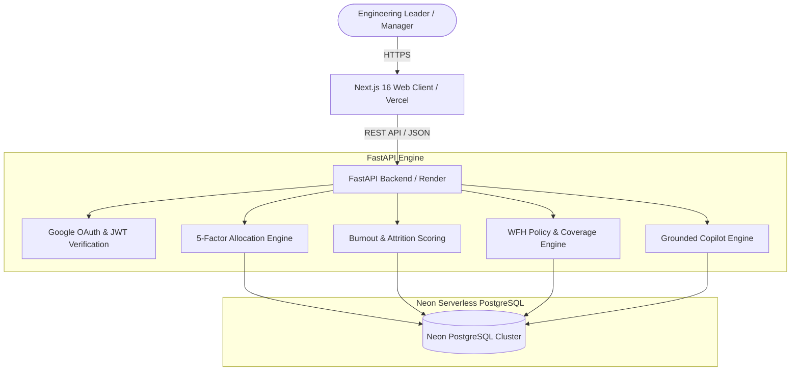

# ORKA — The AI Decision Engine for Engineering Teams

> **Explainable AI decisions for smarter engineering-team execution.**

[](https://github.com/kartikthhakur07/Orka/actions/workflows/ci.yml)
[](https://orka-nu.vercel.app)
[](https://orkapi.onrender.com/docs)
[](https://neon.tech)
[](https://www.python.org)
[](https://nextjs.org)

ORKA is an enterprise decision-support engine designed to optimize task allocation, sprint capacity, burnout prevention, hybrid work schedules, and project delivery risk. Powered by a live **Neon Serverless PostgreSQL** cloud database, ORKA unifies team signals—including verified technical skills, workload headroom, daily availability, cognitive overload indicators, and project deadlines—turning complex engineering trade-offs into explainable, policy-compliant recommendations.

* **Live Application:** [https://orka-nu.vercel.app](https://orka-nu.vercel.app)
* **GitHub Repository:** [https://github.com/kartikthhakur07/Orka](https://github.com/kartikthhakur07/Orka)
* **Backend API Base:** [https://orkapi.onrender.com](https://orkapi.onrender.com)
* **Interactive API Documentation:** [https://orkapi.onrender.com/docs](https://orkapi.onrender.com/docs)
* **Cloud Database:** Hosted on Neon Serverless PostgreSQL (AWS `ap-southeast-1`)

---

## Table of Contents

- [1. Problem Statement](#1-problem-statement)
- [2. Solution Overview](#2-solution-overview)
- [3. Core Features & Modules](#3-core-features--modules)
- [4. Key Differentiators](#4-key-differentiators)
- [5. System Architecture](#5-system-architecture)
- [6. Task Delegation Algorithm](#6-task-delegation-algorithm)
- [7. Technology Stack](#7-technology-stack)
- [8. Repository Structure](#8-repository-structure)
- [9. Neon PostgreSQL Cloud Database](#9-neon-postgresql-cloud-database)
- [10. Installation and Local Setup](#10-installation-and-local-setup)
- [11. Environment Variables](#11-environment-variables)
- [12. API Reference](#12-api-reference)
- [13. Testing and Quality Assurance](#13-testing-and-quality-assurance)
- [14. Security and Responsible AI](#14-security-and-responsible-ai)
- [15. Product Roadmap](#15-product-roadmap)
- [16. Contributing](#16-contributing)
- [17. License](#17-license)

---

## 1. Problem Statement

Engineering managers, team leads, and operations leaders routinely navigate critical execution trade-offs under high uncertainty:

1. **Manual Task Delegation:** Assigning complex tasks relies heavily on intuition or recent recall, frequently leading to sub-optimal skill alignment.
2. **Uneven Workload Distribution:** High performers are repeatedly assigned critical path items, driving up workload while underutilizing available capacity elsewhere.
3. **Burnout and Retention Risks:** Cognitive overload, context switching, and excessive meeting density accumulate undetected until employee resignation occurs.
4. **Inefficient Sprint Planning:** Balancing daily capacity, developer leave, and task complexity across spreadsheet tools consumes hours of manual overhead per sprint.
5. **Unpredictable Deadline Slippage:** Project risk is often identified after milestone dates pass, rather than forecast dynamically from team velocity.
6. **Hybrid Work Coordination:** Coordinating office attendance and remote work policy compliance across distributed team members introduces friction and policy violations.

---

## 2. Solution Overview

ORKA aggregates multi-dimensional team operational telemetry into an explainable decision loop. Instead of acting as an opaque black box or relying on subjective evaluations, ORKA connects directly to **Neon PostgreSQL** and applies deterministic multi-factor scoring and constraint filtering to answer foundational operational questions:

* *Who is best qualified and available to execute a task right now?*
* *How can subtasks be distributed across daily sprint capacity without causing overload?*
* *Which team members show early signs of cognitive strain, and what supportive actions should be taken?*
* *How can a 2-day hybrid work schedule be generated automatically without violating office coverage minimums?*
* *Which project deadlines are projected to slip based on actual team velocity?*

```
┌─────────────────────────┐     ┌─────────────────────┐     ┌────────────────────────┐
│  Live Neon PostgreSQL   │ ──► │  ORKA Engine        │ ──► │  Explainable           │
│  (24 Engineers, Skills, │     │  (5-Factor Model &  │     │  Recommendations       │
│  Capacity, Attrition)   │     │  Constraint Filter) │     │  (Winner, Backup,      │
└─────────────────────────┘     └─────────────────────┘     │  Reason Codes)         │
                                                            └────────────────────────┘
```

---

## 3. Core Features & Modules

| Module / Feature | Route | Status | Purpose & Functionality |
| :--- | :--- | :---: | :--- |
| **Overview Dashboard** | `/dashboard` | 🟢 Active | Central command view aggregating live team health, dynamic sprint burndown, active task counts, burnout watchlists, and recent AI allocations. |
| **AI Task Delegator** | `/delegator` | 🟢 Active | Evaluates tasks against team signals using the 5-factor delegation engine. Features sub-tabs for **AI Task Assign**, **Auto Task Splitter**, and **NLP Sentence Parser**. |
| **AI Decision Copilot** | `/copilot` | 🟢 Active | Enterprise AI decision workstation with real-time operational telemetry sidebar, 1-click diagnostic prompts, categorized quick-focus ribbons, and grounded context Q&A. |
| **Sprint Planner** | `/sprint` | 🟢 Active | Capacity-aware planning board that automatically breaks tasks into sub-items and schedules them into daily capacity windows ($\le 8\text{h/day}$) while respecting member availability. |
| **Burnout Radar** | `/burnout` | 🟢 Active | 14-day cognitive overload tracking system blending workload, context switching, focus hours, meeting load, and attrition risk metrics into actionable interventions. |
| **WFH Decider** | `/wfh` | 🟢 Active | Policy-compliant hybrid work scheduler. Evaluates commute distance, deep-work requirements, collaboration ratios, and office coverage rules to assign optimal remote days. |
| **Deadline Shield** | `/deadline` | 🟢 Active | Velocity-based completion forecasting. Calculates projected vs. required deadline days, identifies bottleneck owners, and simulates workload rebalancing. |
| **Team Builder** | `/team` | 🟢 Active | Full roster management of 24 software engineers, squad generation based on project skill requirements (`POST /api/team/build`), and skill coverage gap analysis (`GET /api/skill-gap`). |
| **Productivity & Work DNA**| `/productivity`| 🟢 Active | Output telemetry, non-surveillance focus profiles (**Work DNA**), focus hour heatmaps, and a meeting waste analyzer (`GET /api/meetings`). |
| **Tasks Management** | `/tasks` | 🟢 Active | Kanban task board and table view supporting real-time CRUD operations, priority filtering, status transitions, and inline assignments. |
| **Executive Analytics** | `/analytics` | 🟢 Active | Workload distribution histograms, priority/status breakdowns, and skill coverage matrices across all engineering divisions. |

---

## 4. Key Differentiators

1. **Direct Neon PostgreSQL Cloud Integration:** Telemetry data is queried in real time with connection pooling (`pool_pre_ping=True`, `pool_recycle=300`) without relying on ephemeral in-memory mock datasets.
2. **Explainable Multi-Factor Allocation:** Every task recommendation provides full factor score breakdowns ($0\text{--}100$), standardized reason codes (`HIGH_SKILL_MATCH`, `CAPACITY_AVAILABLE`, `BURNOUT_SAFE`), and an identified runner-up backup.
3. **Hard Constraint Eligibility Filtering:** High burnout scores ($\ge 75\%$) or max capacity ($\ge 95\%$) automatically trigger eligibility exclusions, preventing high-skill scores from masking burnout risks.
4. **Policy-Compliant Hybrid Work Engine:** Generates fair 2-day hybrid schedules balancing commute stress against office coverage thresholds.
5. **Integrated Decision Support:** Task assignment, sprint capacity, burnout prevention, and deadline projections operate on a single shared relational schema.
6. **Non-Surveillance Productivity Focus:** Evaluates focus block availability, meeting density, and context switching rather than monitoring keystrokes or private messages.

---

## 5. System Architecture

ORKA follows a modern decoupled full-stack architecture. The frontend is built on Next.js 16 (Turbopack) with React 19, deployed on Vercel. The backend is a Python FastAPI service backed by SQLAlchemy ORM, connecting to Neon Serverless PostgreSQL.



---

## 6. Task Delegation Algorithm

The core delegation engine evaluates candidates using a deterministic, multi-factor model:

$$\text{Score} = w_1 \cdot \text{SkillMatch} + w_2 \cdot \text{WorkloadHeadroom} + w_3 \cdot \text{Availability} + w_4 \cdot \text{BurnoutSafety} + w_5 \cdot \text{DeadlineFit}$$

### Factor Definitions & Normalization ($0\text{--}100$)

* **Skill Match ($K$):** Weighted overlap percentage between required task skills and member proficiency.
* **Workload Headroom ($H$):** Remaining capacity, evaluated as $\max(0, 100 - \text{Current Workload \%})$.
* **Availability ($A$):** Daily free working window, evaluated as $\min\left(100, \frac{\text{Free Hours}}{8.0} \times 100\right)$.
* **Burnout Safety ($B$):** Safety margin, evaluated as $\max(0, 100 - \text{Effective Burnout Score})$.
* **Deadline Fit ($D$):** Feasibility score based on task complexity vs. available deadline days.

### Dynamic Weighting Matrix

| Priority Level | $w_1$ (Skill) | $w_2$ (Workload) | $w_3$ (Availability) | $w_4$ (Burnout) | $w_5$ (Deadline) |
| :--- | :---: | :---: | :---: | :---: | :---: |
| **Standard / Medium / Low** | 0.30 | 0.20 | 0.20 | 0.20 | 0.10 |
| **Critical / Urgent** | 0.25 | 0.20 | 0.30 | 0.10 | 0.15 |

### Hard Constraint Eligibility Rules

Before ranking candidates by total score, the engine applies hard eligibility checks:
1. **Burnout Exclusion:** Members with an effective burnout score $\ge 75\%$ are hard-excluded from top assignment recommendations to prevent attrition.
2. **Capacity Exclusion:** Members with workload $\ge 95\%$ are excluded due to lack of headroom.
3. **Approval Flag:** Tasks marked `critical` or assignments with score $< 60$ automatically set `"requires_manager_approval": true`.

*Live response example:*

```json
{
  "assigned_to": "Alex Rivera",
  "confidence": 91,
  "factors": {
    "skill_match": 95.0,
    "workload_headroom": 52.0,
    "availability": 87.5,
    "burnout_safety": 78.0,
    "deadline_fit": 92.0
  },
  "reason_codes": ["HIGH_SKILL_MATCH", "CAPACITY_AVAILABLE", "BURNOUT_SAFE"],
  "backup": "Riya Sharma",
  "excluded_candidates": [
    {
      "name": "Elena Rostova",
      "reason": "Critical burnout risk (84.0/100) — excluded to prevent turnover"
    }
  ]
}
```

---

## 7. Technology Stack

| Layer | Component | Technology |
| :--- | :--- | :--- |
| **Frontend Core** | Web Framework | Next.js 16.2 (App Router & Turbopack), React 19.2 |
| **Frontend Styling** | Styling & UI | Vanilla CSS Tokens, Tailwind CSS, Lucide React Icons |
| **Interactive Components** | Visual Effects | HTML5 Canvas PixelCard, CSS 3D Folder, WebGL LightRays |
| **Frontend Data** | HTTP Client | Native Fetch with exponential backoff retry wrapper |
| **Data Visualization** | Charts & Gauges | Recharts v3.9 (Scatter, Radar, RadialBar, Area, Bar) |
| **Backend Core** | API Framework | Python 3.11+, FastAPI v0.110+ |
| **Backend Web Server** | ASGI Server | Uvicorn (standard) |
| **Database** | Cloud Relational DB | **Neon Serverless PostgreSQL** (SQLAlchemy 2.0 ORM) |
| **Authentication** | OAuth 2.0 & JWT | Google Identity Services tokeninfo API, PyJWT / HMAC-SHA256 |
| **Testing** | Test Runners | Pytest (Backend, 11/11 tests), TypeScript Compiler (`tsc`) |
| **Containerization** | Containers | Docker, Docker Compose (v3.8) |
| **Deployment** | Cloud Hosting | Vercel (Frontend), Render (FastAPI), Neon (PostgreSQL) |

---

## 8. Repository Structure

```
Orka/
├── .github/
│   └── workflows/
│       └── ci.yml                 # GitHub Actions CI pipeline (Pytest & Next.js Build)
├── backend/
│   ├── database.py                # Neon PostgreSQL engine, pooling, and session management
│   ├── Dockerfile                 # Container definition for FastAPI backend
│   ├── main.py                    # FastAPI endpoints, 5-factor engine, and business logic
│   ├── model.py                   # SQLAlchemy ORM models (TeamMember, Task, Project, etc.)
│   ├── requirements.txt           # Python backend dependencies
│   ├── runtime.txt                # Python runtime specification (Python 3.11.9)
│   └── test_main.py               # Automated pytest suite (11 test suites)
├── frontend/
│   ├── public/                    # Logos, custom favicon, sketch artwork, badge assets
│   ├── src/
│   │   ├── app/                   # Next.js App Router routes
│   │   │   ├── analytics/         # Executive Analytics & Workload Distribution
│   │   │   ├── burnout/           # Burnout Radar & Attrition Prevention
│   │   │   ├── copilot/           # AI Decision Copilot Workstation
│   │   │   ├── dashboard/         # Executive Operations Dashboard
│   │   │   ├── deadline/          # Deadline Shield & Velocity Forecasting
│   │   │   ├── delegator/         # 5-Factor Task Delegator Board
│   │   │   ├── login/             # Authentication & 1-Click Role Switcher
│   │   │   ├── productivity/      # Productivity Telemetry & Work DNA
│   │   │   ├── settings/          # Enterprise Settings & Scheduling Policy
│   │   │   ├── sprint/            # Capacity-Balanced Sprint Planner
│   │   │   ├── tasks/             # Live Task CRUD Execution Board
│   │   │   ├── team/              # Team Builder & Skill Gap Analysis
│   │   │   ├── wfh/               # Hybrid Work Decider Grid
│   │   │   ├── Carousel.tsx       # Infinite Multi-Card Workflow Animation
│   │   │   ├── Folder.tsx         # 3D Interactive White Notebook Folders
│   │   │   ├── LightRays.tsx      # Ambient Raycaster Canvas Background
│   │   │   ├── PixelCard.tsx      # Canvas Pixel Particle Hover Effect
│   │   │   ├── TechText.tsx       # Cyber Matrix Text Animation
│   │   │   ├── globals.css        # Clean CSS design system & typography tokens
│   │   │   ├── layout.tsx         # Root layout with Orka Orbit branding
│   │   │   └── page.tsx           # Modern Landing Page
│   │   ├── components/            # Reusable UI widgets (Navbar, Sidebar, TopBar, etc.)
│   │   ├── context/               # React Contexts (AuthContext, SidebarContext)
│   │   └── lib/
│   │       └── api.ts             # API client with automatic retry logic
│   ├── Dockerfile                 # Container definition for Next.js app
│   ├── next.config.ts             # Next.js config
│   ├── package.json               # Frontend dependencies & scripts
│   └── tsconfig.json              # TypeScript strict configuration
├── docker-compose.yml             # Local full-stack multi-container specification
└── README.md                      # Comprehensive project documentation
```

---

## 9. Neon PostgreSQL Cloud Database

ORKA is directly backed by **Neon Serverless PostgreSQL**. All data operations (team telemetry, task assignments, sprint schedules, and Work DNA records) are queried and mutated directly against Neon.

* **Connection Scheme:** `postgresql://...neon.tech/neondb?sslmode=require&channel_binding=require`
* **Connection Pooling:** Enabled via SQLAlchemy connection pool (`pool_pre_ping=True`, `pool_recycle=300`) for high concurrency and serverless cold-start resilience.
* **Persistent Entities:**
  * `team_members` (24 software engineers across all roles, with IBM HR Analytics stress & performance metrics)
  * `tasks` (live sprint backlog with priority, estimated hours, and assignees)
  * `projects` (active project records with risk scores and target deadlines)
  * `sprints` (daily capacity plans and task distributions)
  * `work_dna` (non-surveillance focus and collaboration profiles)
  * `users` (OAuth credentials and session tracking)

---

## 10. Installation and Local Setup

### Prerequisites
* **Node.js:** v20.0.0 or higher
* **npm:** v10.0.0 or higher
* **Python:** v3.11 or higher
* **Docker & Docker Compose:** *(Optional, for containerized execution)*

---

### Option A: Local Development Execution

#### 1. Clone the Repository
```bash
git clone https://github.com/kartikthhakur07/Orka.git
cd Orka
```

#### 2. Backend Setup & Startup
```bash
# Navigate to backend directory
cd backend

# Create and activate virtual environment
python -m venv venv

# Windows (PowerShell):
.\venv\Scripts\Activate.ps1
# macOS/Linux:
source venv/bin/activate

# Install dependencies
pip install -r requirements.txt
pip install pytest httpx

# Start the FastAPI server (connects directly to Neon PostgreSQL)
python -m uvicorn main:app --reload --port 8000
```
*The API is available at `http://localhost:8000`. Swagger documentation is at `http://localhost:8000/docs`.*

#### 3. Frontend Setup & Startup
Open a separate terminal window:
```bash
# Navigate to frontend directory
cd Orka/frontend

# Install dependencies
npm install

# Start Next.js development server
npm run dev
```
*The web app is accessible at `http://localhost:3000`.*

---

### Option B: Docker Compose Execution

To run frontend and backend in unified containers:

```bash
docker-compose up --build
```

* **Frontend:** `http://localhost:3000`
* **Backend:** `http://localhost:8000`

---

## 11. Environment Variables

### Frontend Environment Variables (`frontend/.env.local`)

| Variable Name | Required | Default / Description |
| :--- | :---: | :--- |
| `NEXT_PUBLIC_API_URL` | Yes | `http://localhost:8000` (Local) or `https://orkapi.onrender.com` (Production) |
| `NEXT_PUBLIC_GOOGLE_CLIENT_ID` | Optional | Google OAuth 2.0 Web Client ID |

### Backend Environment Variables (`backend/.env`)

| Variable Name | Required | Description |
| :--- | :---: | :--- |
| `DATABASE_URL` | Yes | Neon Serverless PostgreSQL connection string |
| `GOOGLE_CLIENT_ID` | Optional | Google OAuth 2.0 Client ID for server tokeninfo verification |
| `JWT_SECRET` | Optional | Secret key for signing session JWT tokens |
| `PORT` | No | Server port (default: `8000`) |

---

## 12. API Reference

All backend endpoints are served from `backend/main.py` and communicate via JSON.

### Authentication Endpoints
* `POST /api/auth/google` — Authenticate Google OAuth 2.0 ID tokens; returns session JWT and user profile.
* `GET /api/auth/me` — Retrieve current authenticated session identity.

### System & Health Endpoints
* `GET /` — Root service metadata and API health confirmation.
* `GET /api/health` — Health check endpoint returning status `ok` and server timestamp.

### Operational Core Endpoints
* `GET /api/dashboard` — Live metrics from Neon: team health, sprint progress, burnout index, and recent assignments.
* `POST /api/tasks/assign` — 5-Factor AI task delegation engine returning winner, confidence, backup, and factor breakdown.
* `POST /api/tasks/split` — Splits large engineering tasks into subtask sequences with estimated hours.
* `POST /api/tasks/parse` — NLP description parser extracting required skills, complexity, and dependencies.
* `GET /api/tasks` — Retrieves tasks filtered by status, priority, or search term.
* `POST /api/tasks` — Creates new task in Neon PostgreSQL.
* `PATCH /api/tasks/{task_id}` — Updates task details or status.
* `DELETE /api/tasks/{task_id}` — Deletes task from Neon PostgreSQL.
* `GET /api/sprint` — Retrieves active sprint schedule and daily capacity breakdown.
* `POST /api/sprint/generate` — Generates capacity-balanced daily sprint schedule ($\le 8\text{h/day}$ limit).
* `GET /api/burnout` — Computes 14-day cognitive overload indicators, stress scores, and supportive interventions.
* `GET /api/wfh` — Generates policy-compliant 2-day hybrid work schedules.
* `GET /api/deadline` — Forecasts project completion days vs. deadline constraints based on team velocity.
* `POST /api/copilot` — Natural language operational QA interface returning grounded answers with data telemetry sources.
* `GET /api/team` — Retrieves all 24 team members, current workloads, skills, and performance ratings from Neon.
* `POST /api/team` — Adds a new engineer to Neon PostgreSQL.
* `POST /api/team/build` — Synthesizes optimal squads matching project skill requirements.
* `GET /api/skill-gap` — Analyzes required vs. available team skills and outputs hiring/training recommendations.
* `GET /api/productivity` — Retrieves team output telemetry, consistency scores, and focus hour heatmaps.
* `GET /api/work-dna` — Retrieves non-surveillance work style profiles and peak focus windows.
* `GET /api/meetings` — Evaluates meeting schedule density and identifies focus hour recovery opportunities.
* `POST /api/rebalance` — Reallocates tasks from overloaded team members to available engineers.

---

## 13. Testing and Quality Assurance

ORKA includes automated test suites for both backend and frontend layers:

### Backend Testing (Pytest)
```bash
cd backend
pytest test_main.py -v
```
*Validates 11 test suites: health check, dashboard metrics, IBM HR team member schema, algorithmic scoring, task assignment, burnout radar, WFH decider, copilot QA, NLP task parser, task CRUD, and executive analytics.*

### Frontend Verification
```bash
cd frontend
# TypeScript compiler validation (0 errors)
npx tsc --noEmit

# Production build compilation
npm run build
```

---

## 14. Security and Responsible AI

1. **Authentication & Authorization:** Secure Google OAuth 2.0 ID tokens verified server-side against Google's tokeninfo API. Session tokens are signed using HMAC-SHA256 JWTs.
2. **Database Security:** Cloud communication with Neon PostgreSQL enforces SSL encryption (`sslmode=require`).
3. **Privacy of Sensitive Metrics:** Burnout and stress scores are framed strictly as supportive decision-support indicators for managers. Personal telemetry is protected and not displayed on public performance leaderboards.
4. **Non-Surveillance Principle:** ORKA does not monitor keystrokes, track screen activity, or inspect private messages. Telemetry is derived strictly from task output, calendar load, and workload stats.
5. **Human Oversight:** High-complexity tasks or low-confidence recommendations explicitly output `"requires_manager_approval": true`, ensuring final decision authority remains with human leads.

---

## 15. Product Roadmap

```
  v2.0 (Current)               v2.1 (Next Release)          v2.2 (Planned)
┌──────────────────────┐     ┌──────────────────────┐     ┌──────────────────────┐
│ • Neon PostgreSQL DB │ ──► │ • Configurable       │ ──► │ • Two-Way Jira Sync  │
│ • 24 Active Engineers│     │   Algorithm Weights  │     │ • GitHub PR Webhooks │
│ • Copilot Workstation│     │ • Persistent Audit   │     │ • Slack Action Bot   │
│ • 5-Factor Engine    │     │   Event Log          │     │ • ML Weight Learning │
│ • Attrition Scoring  │     │ • Custom Team Roles  │     │   from Outcomes      │
└──────────────────────┘     └──────────────────────┘     └──────────────────────┘
```

---

## 16. Contributing

Contributions are welcome! Please follow standard pull request workflows:

1. **Fork the Repository:** Create your own fork of `kartikthhakur07/Orka`.
2. **Create a Feature Branch:** `git checkout -b feature/amazing-feature`
3. **Commit Your Changes:** `git commit -m 'feat: Add amazing feature'`
4. **Run Verification Tests:** Ensure `pytest` passes in `backend/` and `npm run build` succeeds in `frontend/`.
5. **Push to Branch:** `git push origin feature/amazing-feature`
6. **Open a Pull Request:** Submit your PR against the `main` branch.

---

## 17. License

MIT License. Copyright (c) 2026 ORKA Contributors.

---

**ORKA — Smarter engineering-team execution powered by explainable AI and Neon PostgreSQL.**
